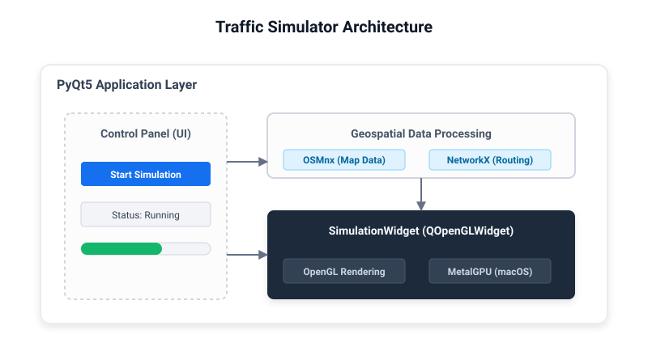

# Building a High-Performance Geographic Traffic Simulator

Developing a real-time geographic traffic simulation requires a clean separation of concerns between the UI, data processing, and rendering. In this post, I'll walk through the architecture of a custom traffic simulator I built using **PyQt5** for the interface, **OpenGL** for graphics, and optional GPU acceleration modules to keep the simulation running smoothly.

---



## 1. Handling Dependencies and Hardware Acceleration

When building a simulator meant to run on various systems, graceful degradation is essential. The application tries to load hardware-specific compute kernels (like Apple's Metal via `metalgpu`) during initialization. If they aren't available, it falls back without crashing.

### **Why this matters:**
- **Reliability:** By defaulting to CPU-bound spatial processing (via `numpy` and `networkx`), the simulator remains cross-platform and reliable.
- **Dynamic Loading:** We use a similar pattern for UI styling (`qt_material`), preventing the app from breaking if a user's environment lacks certain design libraries.

```python
import sys
import time
import numpy as np
import osmnx as ox
import networkx as nx

# Probe for hardware-specific compute kernels
try:
    import metalgpu as mg
    METALGPU_AVAILABLE = True
except ImportError:
    METALGPU_AVAILABLE = False
```

---

## 2. Managing UI and GPU Synchronization

One of the biggest challenges in a desktop graphics application is preventing the UI event loop from interfering with the rendering context. To handle this, we enforce Vertical Synchronization (VSync) using `QSurfaceFormat`.

By setting the swap interval to `1`, we ensure the double-buffered swap chain stays synchronized with the monitor's refresh rate. This prevents screen tearing and stops the CPU from over-allocating draw calls, which keeps thermal throttling in check.

```python
from PyQt5.QtGui import QSurfaceFormat
from PyQt5.QtWidgets import QApplication, QMainWindow, QWidget, QVBoxLayout, QPushButton, QLabel
from PyQt5.QtWidgets import QOpenGLWidget
from OpenGL.GL import *

# Enforce hardware-synchronized swap chains
fmt = QSurfaceFormat()
fmt.setSwapInterval(1) 
QSurfaceFormat.setDefaultFormat(fmt)
```

---

## 3. The OpenGL Rendering Context

Rather than relying on higher-level abstractions that add overhead, the core visual engine subclasses `QOpenGLWidget`. This keeps the OpenGL state machine isolated from the PyQt event loop, ensuring thread safety when updating vertex buffers.

### **Core Methods:**
- **`initializeGL()`**: Sets up the depth buffer and configures z-culling.
- **`paintGL()`**: Executes the main render pass, clearing the buffers before flushing the new frame to the GPU.

```python
class SimulationWidget(QOpenGLWidget):
    def __init__(self, parent=None):
        super().__init__(parent)

    def initializeGL(self):
        glEnable(GL_DEPTH_TEST)  # Enable hardware z-culling
        glClearColor(0.1, 0.1, 0.1, 1.0) 

    def resizeGL(self, w, h):
        glViewport(0, 0, w, h)  # Update device coordinates

    def paintGL(self):
        glClear(GL_COLOR_BUFFER_BIT | GL_DEPTH_BUFFER_BIT) 
```

---

## 4. UI Threading and Background Workers

The `MainWindow` acts as the orchestrator. To keep the `SimulationWidget` rendering smoothly at 60 FPS, all heavy spatial calculations (like A* pathfinding across the `networkx` graph) must be offloaded to background threads. 

The main UI thread is kept deliberately light—its only job is to dispatch background tasks, update status labels, and tell the OpenGL context when it's time to repaint.

```python
class MainWindow(QMainWindow):
    def __init__(self):
        super().__init__()
        self.setWindowTitle("Traffic Simulator")
        self.setGeometry(100, 100, 800, 600) 
        
        # ... UI setup omitted ...
        
        self.start_btn.clicked.connect(self.start_simulation)

    def start_simulation(self):
        self.status_label.setText("Running Simulation...")
        # Dispatch spatial graph traversal to a QThread worker pool
```

---

## Looking Forward

By isolating the OpenGL rendering from the Qt Event loop, the application maintains sub-millisecond latency even during heavy graph traversal workloads. On machines where `metalgpu` is available, offloading vector math to the GPU provides a noticeable performance bump.

In future iterations, I plan to move the A* agent routing logic entirely into compute shaders. This will bypass the Python Global Interpreter Lock (GIL) and take full advantage of the GPU for parallel processing.mulations

Happy coding!
