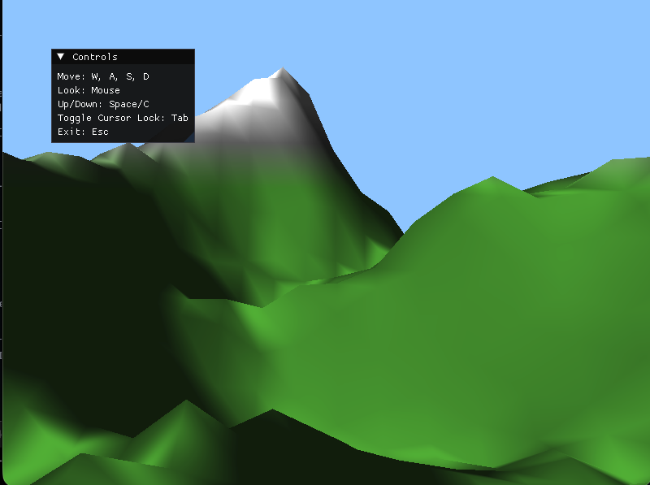

# Building a 3D OpenWorld Simulation with Metal and C++

Developing a 3D environment from scratch requires balancing rendering performance with structural complexity. This post explores `metal_test_cpp`, a lightweight 3D simulation engine I built using Apple's Metal API, GLFW, and C++. The project serves as an exploration into low-level graphics pipelines, memory management, and procedural generation on macOS.

---

## System Overview

At its core, `metal_test_cpp` implements a procedurally generated landscape featuring an interactive free-look camera and basic entity rendering. The goal wasn't just to put pixels on the screen, but to design a rendering loop that respects hardware constraints.

### 1. Procedural Terrain Generation

Dynamically generating terrain is computationally expensive. Using fractal noise, the engine generates an organic, mountainous landscape on the fly. To prevent this from blocking the main thread, the vertex generation is processed efficiently in memory.

By structuring the vertex data carefully, we maintain good cache locality during the noise evaluation phase. The terrain shading relies on height-based interpolation—transitioning from grass to rock and snow—calculated directly in the shader to keep the memory footprint low.

### 2. Managing Metal Pipeline States

The lighting model is a standard diffuse implementation, but the real challenge in any graphics engine is managing pipeline state objects (PSOs). Frequent state changes stall the GPU.

In this project, the rendering pass minimizes PSO switches by grouping draw calls by material. The fragment and vertex shaders are kept lightweight, ensuring high occupancy on the GPU cores.

### 3. Scene Composition & Memory Layout

Rendering objects like trees and rocks across an open world quickly introduces overhead if not managed well. Rather than allocating individual objects haphazardly on the heap, the engine maintains them in contiguous memory buffers. This approach significantly improves L1/L2 cache hits when iterating through entities for frustum culling and transformation updates.

### 4. Camera Kinematics and Collision

The free-look camera supports standard WASD movement with altitude controls. A critical feature was implementing terrain collision so the camera doesn't clip through the ground.

Instead of expensive mesh-level collision checks on every frame, the simulation queries the terrain heightmap directly at the camera's X/Z coordinates. This localized lookup is highly efficient, taking only microseconds to resolve and keeping the frame rate steady.

### 5. Telemetry with Dear ImGui

For debugging, I integrated Dear ImGui. To keep the rendering pipeline clean, the ImGui draw data is batched and executed as a final, overlay pass. This makes it easy to tweak simulation parameters in real-time without disrupting the core rendering logic.

---

## Under the Hood

The architecture leverages **Objective-C++** for interfacing with the Metal API and **pure C++** for the engine logic.

*   **Metal:** Provides low-overhead access to the GPU, enabling high draw-call throughput.
*   **GLFW:** Handles windowing and input management cleanly across platforms.
*   **simd:** Apple's SIMD library is used for fast, vectorized mathematical operations (matrices, vectors), which is essential for 3D transformations.

## Future Improvements

While `metal_test_cpp` provides a solid foundation, there are several areas for optimization. Future work will focus on integrating a more robust Entity Component System (ECS) for better scaling, and offloading more of the procedural generation tasks to compute shaders to fully utilize the GPU.
