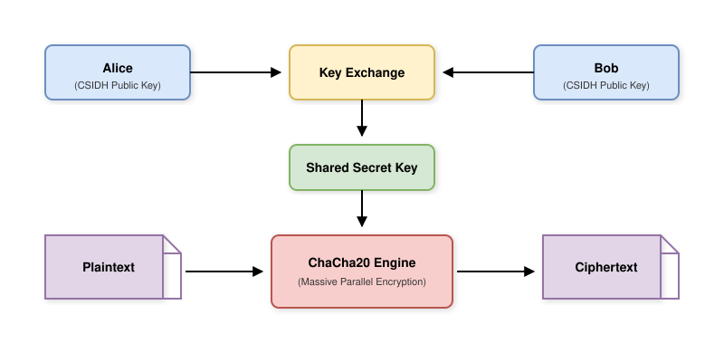

We all know it's coming. Quantum computers are slowly but surely scaling up, and when they reach a certain threshold of stable qubits, traditional public-key cryptography (like RSA and ECC) will be broken by Shor's algorithm. 

To get ahead of the curve, I've been developing **[PiQME](https://github.com/piyushS3V3N/piqme)**, a high-performance, cross-platform post-quantum cryptographic tool. 

### How PiQME Works

The core philosophy behind PiQME is to combine cutting-edge post-quantum key exchange with brutally fast symmetric encryption. 

Here is a high-level architecture diagram of the flow:

*PiQME's hybrid cryptographic pipeline.*

1. **CSIDH (Commutative Supersingular Isogeny Diffie-Hellman):** For the key exchange, I opted for CSIDH. Unlike some other post-quantum algorithms that have massive key sizes (looking at you, lattice-based crypto), CSIDH has incredibly small keys. It functions similarly to traditional Diffie-Hellman, making it an excellent drop-in replacement for quantum-resistant forward secrecy.
2. **ChaCha20:** Once the shared secret is established via CSIDH, the actual payload encryption is handed off to ChaCha20. I implemented a massively parallel version of ChaCha20 to ensure that large files can be encrypted and decrypted with extremely high throughput across multiple CPU cores.

### Why not just use AES?

While AES-256 is generally considered quantum-safe (Grover's algorithm only halves the effective key size to 128 bits, which is still secure), ChaCha20 is inherently faster in software on devices without dedicated AES hardware instructions. By heavily parallelizing the ChaCha20 stream cipher, PiQME can achieve blistering speeds across a wide variety of platforms.

### Enter Apple's Metal API: GPU Acceleration

What really sets PiQME apart from standard implementations is our approach to hardware acceleration. Traditional ChaCha20 implementations rely on CPU SIMD instructions (like AVX2 or NEON). We took a different path entirely by deeply integrating with Apple's **Metal API**.

Because ChaCha20 is a stream cipher (it generates a keystream block based on a counter and XORs it with the plaintext), it is *embarrassingly parallel*. We wrote custom Metal compute shaders that offload the keystream generation directly to the Mac's GPU. 

Instead of processing a file sequentially on a few CPU threads, PiQME divides the payload into massive grids and dispatches thousands of GPU threads to generate the keystream matrix simultaneously. This custom compute pipeline allows PiQME to chew through multi-gigabyte files at speeds that leave traditional CPU-bound encryptors in the dust. We also added specialized memory pooling to seamlessly stream data to the GPU without bottlenecking the system bus.
### Implementing CSIDH in Pure C

Building PiQME was essentially a crash course in advanced number theory and extreme low-level C programming. I didn't want to rely on heavy external libraries like OpenSSL, so the entire cryptographic core is written from scratch. Translating the CSIDH whitepapers into code was just the first step. The real nightmare was ensuring the implementation was actually secure against side-channel attacks. 

When computing isogenies of elliptic curves, you are dealing with massive prime numbers. I had to write a custom multi-precision arithmetic library (bignum) in pure C just to handle the mathematical operations. The trickiest part was guaranteeing **constant-time execution**. If an `if/else` branch takes slightly longer based on a bit of the secret key, an attacker can measure the CPU cycles and steal the key. 

To fix this, I had to completely eliminate branching from the core math loops. Instead of using `if (bit == 1)`, I had to rely on bitwise masking and arithmetic logic (`value = (mask & A) | (~mask & B)`) to ensure every operation took the exact same number of CPU cycles, regardless of the input data. Debugging segfaults in constant-time Montgomery multiplication loops is something I wouldn't wish on my worst enemy.

If you want to poke around the source code or test out the encryption yourself, check out the repository on GitHub. Just remember: it's still experimental, so don't use it to secure your life savings quite yet!
