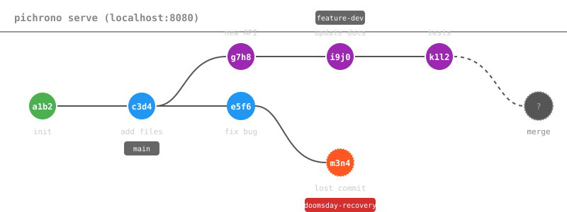

I recently started working on **[Pichrono](https://github.com/piyushS3V3N/pichrono)**, a custom Version Control System (VCS) written entirely from scratch in C. The pitch? A high-performance, lightweight VCS that implements the core data structures of Git—content-addressable storage, Merkle trees, Directed Acyclic Graphs (DAGs)—and includes a "doomsday plan" to recover lost work.

Sounds pretty cool, right? Well, let me tell you about the reality of building a VCS in C.

*A look at the commit tree.*

### The Reality of "Content-Addressable Storage"

In theory, storing files based on their SHA-1 hash is an elegant concept. You hash the file contents, compress it with ZLIB, and write it to disk. Identical files get deduplicated automatically. Magic!

In practice, working with ZLIB in raw C is a fantastic way to corrupt your data if you miscalculate your buffer sizes by even a single byte. Dealing with raw byte streams, hashing them efficiently without loading massive files entirely into memory, and then making sure the inflated/deflated blobs match up is an exercise in extreme patience. You haven't truly lived until a minor pointer arithmetic error corrupts your entire commit tree right as you try to read it back.

### The Embedded Web Server (Because the Terminal Isn't Enough)

Git log is great, but visualizing a massive DAG of commits in the terminal can be hard. So, I decided to embed a C-based web server using Mongoose. The idea was to serve a professional, SVG-rendered commit tree directly to the browser when you run `make serve`.

Writing HTML and SVG dynamically inside C strings using `snprintf` is... an experience. It works, and when it renders that beautiful commit graph in the browser, it feels incredibly rewarding. But the journey to get there involved wrestling with HTTP headers, memory leaks on every refresh, and ensuring the local server doesn't just crash when a request drops mid-stream.

### The "Doomsday Plan"

The standout feature of Pichrono is its doomsday recovery system. If you mess up, lose a branch, or somehow orphan your commits, Pichrono has an aggressive object scanner and a built-in reflog. It scans the raw objects directory, reads the headers, reconstructs the DAG by brute force, and figures out what's missing.

Why did I build this? Because during development, I kept accidentally detaching my own references and losing test data. The "doomsday plan" wasn't just a feature; it was a survival mechanism for developing the VCS itself. When your primary tool for tracking code changes is the very tool you are breaking, you need a backup plan.

### Was it worth it?

Building Pichrono has been arguably one of the most punishing and educational projects I've taken on. You don't realize how many edge cases Git gracefully handles until you try to recreate it. File permissions, symlinks, cross-platform line endings, race conditions on disk writes—it's a massive undertaking.

Would I recommend you drop Git and use Pichrono for your production codebase? Absolutely not. 

But if you want to truly understand how Git works under the hood, I highly recommend trying to build a terrible, broken version of it yourself in C. You'll gain a permanent, profound respect for Linus Torvalds.
