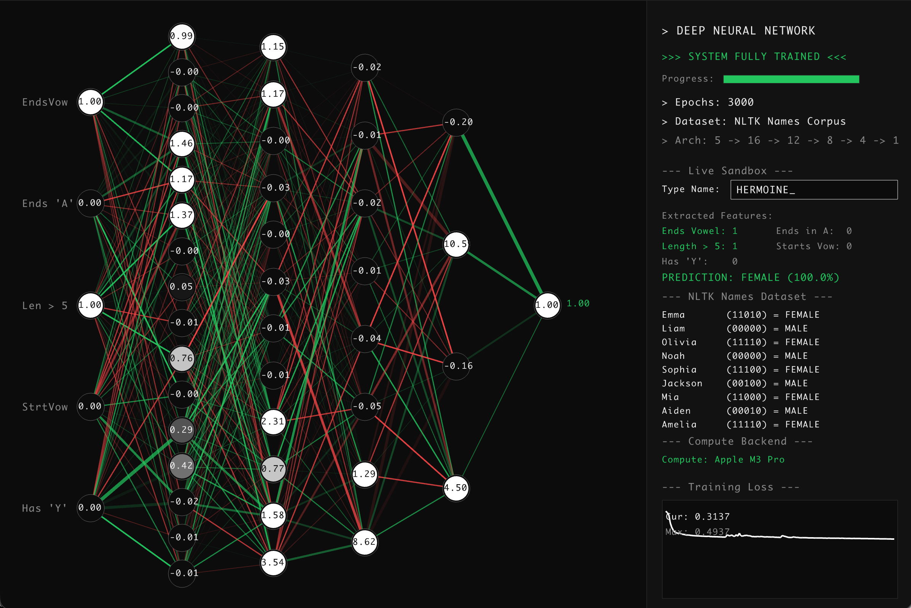

I've been hacking on a side project recently called **Neural-C**. Basically, I wanted to see if I could build a deep neural network entirely from scratch in C, without relying on massive libraries like TensorFlow or PyTorch. It forces you to actually learn the math behind matrix multiplication and backpropagation instead of just calling `model.fit()`.

To make it actually usable, I hooked it up to Apple's Metal API for GPU acceleration, and threw together a real-time visualizer using Raylib so I could see what was happening under the hood.

Here's a look at the live visualizer doing its thing:

### The cool stuff

Honestly, the best part is the speed. By writing compute shaders in Metal and dispatching them from Objective-C, all the heavy matrix math gets dumped onto the Mac's GPU. It runs surprisingly fast. 

The Raylib visualizer is also pretty neat. You can watch the weights update and the loss graph drop in real-time. I even added a feature where you can press '1' or '0' while it's running to correct bad predictions on the fly and force it to re-evaluate. 

### What sucks (and what I need to fix)

Since this is a custom engine built from the ground up, there are a lot of rough edges I'm currently wrestling with:

**1. It only runs on Macs**
Because I heavily relied on Apple's Metal API to make it fast, the project is completely locked to macOS. If you try to compile this on Linux or Windows, it just won't work. Eventually, I need to rip out the hardcoded Metal stuff and support something cross-platform like Vulkan or OpenCL.

**2. Manual memory management**
Writing everything in raw C means dealing with `malloc` and `free` everywhere. It's fine for the basic setup I have now, but if I try to scale this up to handle much larger datasets or deeper networks, keeping track of memory without leaking is going to become a nightmare. 

**3. It's too rigid**
Right now, the architecture is basically hardcoded. If I want to add new layer types (like CNNs or LSTMs), it requires writing a ton of boilerplate C code. I need to spend some time designing a better, more modular API where I can just stack different layers easily.

### Wrapping up

Despite the headaches, Neural-C has been a really fun way to push C and macOS graphics APIs to their limits. It even has persistent memory (saving weights to a simple `brain.bin` file), so the model actually remembers what it learned between runs.

There's clearly a lot of work left to do, especially making it run on other operating systems, but it's a solid start. 
